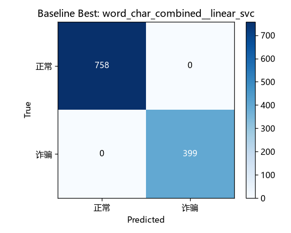
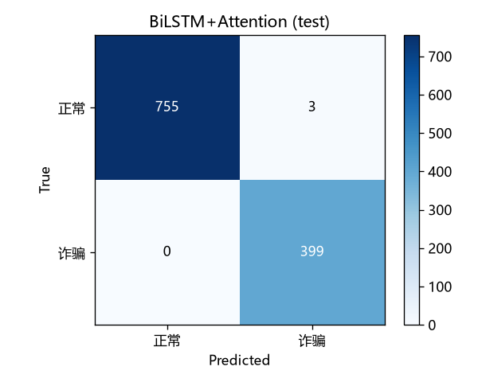

# 文本诈骗检测模型训练报告（Telecom_Fraud_Texts_5）

> 训练日期：2026-10-12
> 对应任务：数据准备 → TF-IDF+LinearSVC 基线 → BiLSTM+Attention 深度模型 → 测试集评估 → 端到端验证
> 未修改 `anti_fraud_text.py` 的三层融合逻辑与模型文件名约定（`text_baseline.joblib` / `text_bilstm.pt`）。

## 1. 数据集说明

**来源**：Telecom_Fraud_Texts_5，5 个 CSV，两列表头 `content,label`，与数据集自带 LICENSE（GPLv3，已保留于 `data/raw/`）。

**编码处理**：读取按 `utf-8-sig → gbk` 顺序尝试。实测 label00~03 为 utf-8-sig，**label04 为 GBK**（与任务说明一致）。

**标签映射**：二分类；原始 label 值留存于 `category` 列：

| 文件 | 解析行数 | 编码 | 原始 label 值（=category） | 二分类 label |
|---|---:|---|---|---:|
| label00-last.csv | 7773 | utf-8-sig | `0`（正常文本，运营商营销短信等） | 0 |
| label01-last.csv | 1000 | utf-8-sig | 冒充公检法及政府机关类 | 1 |
| label02-last.csv | 1000 | utf-8-sig | 贷款、代办信用卡类 | 1 |
| label03-last.csv | 1000 | utf-8-sig | 冒充客服服务 | 1 |
| label04-last.csv | 1000 | gbk | **冒充领导、熟人类**（实测文件内原始值；README 同此。与任务描述中的"杀猪盘类"不一致，以文件实际内容为准） | 1 |
| **合计** | **11773** | | | |

> 注1：任务描述给出 label00≈7838 / 总计≈11838，为约数；pandas 按 CSV 引号规则实际解析 7773 / 11773 行。
> 注2：未使用任何合成话术数据，本轮全部基于 Telecom_Fraud_Texts_5 原始语料。

**清洗**（[scripts/prepare_dataset.py](../scripts/prepare_dataset.py)）：

- 去除 content 为空/纯空白：0 条
- 按 content 去重：11773 → **11570**（删除 203 条重复）
- 超长文本（>500 字）：6 条，**采取截断到前 500 字保留**（保留其前段诈骗话术信息；深度模型 max_len=128 还会再截）
- 清洗后 正常(0)=7573，诈骗(1)=3997

**类别分布（清洗后）**：

| category | 条数 |
|---|---:|
| 0（正常） | 7573 |
| 贷款、代办信用卡类 | 1000 |
| 冒充公检法及政府机关类 | 999 |
| 冒充客服服务 | 999 |
| 冒充领导、熟人类 | 999 |

**切分**：按 label 分层抽样，train/val/test = **8:1:1**，`random_state=42`，输出表头 `content,label,category`：

| 集合 | 总数 | 正常(0) | 诈骗(1) |
|---|---:|---:|---:|
| train | 9256 | 6058 | 3198 |
| val | 1157 | 757 | 400 |
| test | 1157 | 758 | 399 |

## 2. 模型一：TF-IDF + LinearSVC 传统基线

[scripts/train_text_baseline.py](../scripts/train_text_baseline.py)，4 种特征 × 3 种模型共 12 组 ablation，按 5 折分层 CV-F1 选最优；完整对比见 `data/text/stats/baseline_summary.md`。

**最优组合：词级 TF-IDF(1-gram, 5000) + 字符级 TF-IDF(char_wb, 2-4gram, 5000) → CalibratedClassifierCV(LinearSVC, sigmoid)**

- 测试集 **accuracy = 1.0000**；CV-F1(weighted) = 0.9991
- 训练耗时 255.1 秒（含 12 组实验 + 12×5 折交叉验证）

| 类别 | precision | recall | F1 | support |
|---|---:|---:|---:|---:|
| 0 正常 | 1.0000 | 1.0000 | 1.0000 | 758 |
| 1 诈骗 | 1.0000 | **1.0000** | 1.0000 | 399 |

混淆矩阵（test, n=1157）：

| 真实\预测 | 正常 | 诈骗 |
|---|---:|---:|
| 正常 | 758 | 0 |
| 诈骗 | 0 | 399 |



**超参数**：SVC `C=1.0, max_iter=2000, class_weight=balanced, dual=auto`；CalibratedClassifierCV `cv=2, method=sigmoid`；
TF-IDF `min_df=1, max_df=0.95`；CV 5 折；random_state=42；分词 jieba（与推理端 `anti_fraud_text.py` 构造 tokens 的方式一致）。

## 3. 模型二：BiLSTM + Attention 深度模型

[scripts/train_text_bilstm.py](../scripts/train_text_bilstm.py)，字符级输入，Embedding(128) → 2 层双向 LSTM(hidden 128) → Self-Attention → Dropout 0.5 → Linear。

- 参数量 1,100,418；字符词表 3312（仅由训练集构建）
- 最多 30 epoch、patience=5 早停，**实际运行 8 epoch**（epoch 3 与 epoch 8 两次达到 val_f1=1.0，之后早停）
- 训练耗时 **336.8 秒（约 5.6 分钟）**，远低于 2 小时阈值，故使用默认超参（epochs=30、batch_size=32），未降配
- 测试集 **accuracy = 0.9974**

| 类别 | precision | recall | F1 | support |
|---|---:|---:|---:|---:|
| 0 正常 | 1.0000 | 0.9960 | 0.9980 | 758 |
| 1 诈骗 | 0.9925 | **1.0000** | 0.9963 | 399 |

混淆矩阵（test, n=1157）：

| 真实\预测 | 正常 | 诈骗 |
|---|---:|---:|
| 正常 | 755 | 3 |
| 诈骗 | 0 | 399 |



**超参数**：epochs_max=30（实际 8，早停 patience=5），batch_size=32，lr=1e-3，Adam，CrossEntropyLoss，
embed_dim=128，hidden_dim=128，num_layers=2，bidirectional，dropout=0.5，max_len=128（字符），seed=42。

## 4. 运行环境

| 项 | 值 |
|---|---|
| 操作系统 | Windows 11 (10.0.22631) |
| CPU | AMD Ryzen 7 5800H（纯 CPU 训练，无 GPU） |
| Python | 3.14.0 |
| scikit-learn | 1.9.1 |
| pandas / numpy | 3.0.6 / 2.5.3 |
| joblib / jieba | 1.6.0 / 0.42.1 |
| torch | 2.14.1+cpu（CUDA 不可用） |

## 5. 验收硬指标核对

| 验收项 | 阈值 | TF-IDF+LinearSVC | BiLSTM+Attention | 结论 |
|---|---|---:|---:|---|
| 测试集 accuracy | ≥ 85% | **100.00%** | **99.74%** | ✅ 均达标 |
| 诈骗类(label=1) recall | ≥ 90% | **100.00%** | **100.00%** | ✅ 均达标，零漏报 |

补充：BiLSTM 有 3 条正常文本被误报为诈骗（特异度 99.60%），符合"宁可误报不可漏报"的反诈取向；baseline 测试集无误报。
需要说明：Telecom 语料本身模板化程度较高（诈骗话术高度雷同、正常文本为运营商短信），
测试集与训练集同源，100% 的指标可能高估对真实世界陌生话术的泛化能力；上线后应以真实流量 badcase 持续回归。

## 6. 端到端验证（三层融合链路）

重启 Flask（`cd flask_app && python app.py`，`GET /api/health` 返回 `status=ok, text=true`），
`POST /api/detect/text` 实测 4 条规定文本，实际返回 JSON 原文如下：

**① 需要提前缴纳培训费10000元才能办理入职 → 期望高风险，实际 高风险（100）✅**

```json
{"detail":"命中关键词：培训费、提前缴纳、入职、缴纳；匹配诈骗模式：入职/办理前要求缴纳费用、要求预先支付钱款、以免费福利为诱饵","keywords":["培训费","提前缴纳","入职","缴纳"],"patterns":["入职/办理前要求缴纳费用","要求预先支付钱款","以免费福利为诱饵"],"riskLevel":"高风险","riskScore":100}
```

**② 我们养老院可以免费接收老人抚养，请填写身份相关信息 → 期望高风险，实际 高风险（90）✅**

```json
{"detail":"匹配诈骗模式：以免费福利为诱饵、免费照护老人/儿童骗局、诱导填写/提供个人敏感信息","keywords":[],"patterns":["以免费福利为诱饵","免费照护老人/儿童骗局","诱导填写/提供个人敏感信息"],"riskLevel":"高风险","riskScore":90}
```

**③ 明天下午三点组会记得带上周的报告 → 期望低风险，实际 低风险（2）✅**

```json
{"detail":"ML模型预测（TF-IDF + 分类器），诈骗概率 1.54%","keywords":[],"patterns":[],"riskLevel":"低风险","riskScore":2}
```

**④ 您的快递已放驿站，取件码6-2-3018 → 期望低风险，实际 低风险（0）✅**

```json
{"detail":"未检测到明显诈骗特征，文本内容相对安全","keywords":[],"patterns":[],"riskLevel":"低风险","riskScore":0}
```

4/4 与期望一致；②号文本规则层未命中关键词，由模式规则 + 本地模型层兜住，说明三层融合在真实短句上工作正常。

## 7. 结论：线上主模型选择

**主模型：TF-IDF（词+字符）+ Calibrated LinearSVC（`models/text_baseline.joblib`）**，理由：

1. 测试集指标与 BiLSTM 持平（acc 100% vs 99.74%，诈骗召回同为 100%）且无误报；
2. 权重仅 **0.51 MB**（BiLSTM 4.21 MB），CPU 毫秒级推理，部署不依赖 torch；
3. 概率经 sigmoid 校准，直接供三层融合打分。

**BiLSTM（`models/text_bilstm.pt`）作为融合架构中的深度学习第二意见层保留**：对规则和词法特征不敏感的变体话术提供语义兜底，并可用于与主模型做交叉验证（两者预测分歧的样本进入人工复核队列）。
当前 `anti_fraud_text.py` 本就按"规则 + ML + DL 取最高分"融合，无需改动。

## 8. 产出文件清单与权重处置

**代码/报告（随 git 提交）**：

- `scripts/prepare_dataset.py`（新增）
- `scripts/train_text_baseline.py`、`scripts/train_text_bilstm.py`、`scripts/deep_text_common.py`（适配新数据格式 + 报告产物）
- `reports/text_model_report.md`、`reports/confusion_matrix_baseline.png`、`reports/confusion_matrix_bilstm.png`、`reports/baseline_metrics.json`、`reports/bilstm_metrics.json`
- `data/raw/Telecom_Fraud_Texts_5-main/`：5 个 CSV（git add -f 强制添加）+ LICENSE
- 中间产物：`data/text/processed/{train,val,test}.csv`、`data/text/stats/*`（被 .gitignore 忽略，仅本地）

**模型权重（被 .gitignore 忽略，未提交，等待人工决定分发方式）**：

| 文件 | 字节 | 大小 |
|---|---:|---:|
| models/text_baseline.joblib | 535,710 | 0.51 MB |
| models/text_bilstm.pt | 4,409,297 | 4.21 MB |
| models/text_bilstm_vocab.json | 51,716 | 0.05 MB |
| models/text_bilstm_meta.json | 2,399 | 2.3 KB |

**未解决/需人工决定的问题**：

1. 当前源码目录是下载解压包，**本身没有 .git 仓库**，已在本地 `git init` 后完成首次提交（未配置 remote、未 push）；权重未纳入提交，请决定用 Gitee LFS 还是发行版附件分发。
2. 任务描述称 label04 为"杀猪盘类"，实测文件原始类别为"冒充领导、熟人类"，已按文件实际值处理并留存 category，如数据集版本不同请确认。
3. 指标在同源切分上接近满分，建议后续用真实流量新话术做跨域测试集再评估泛化性。
