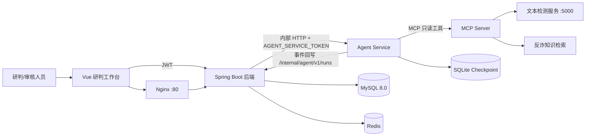
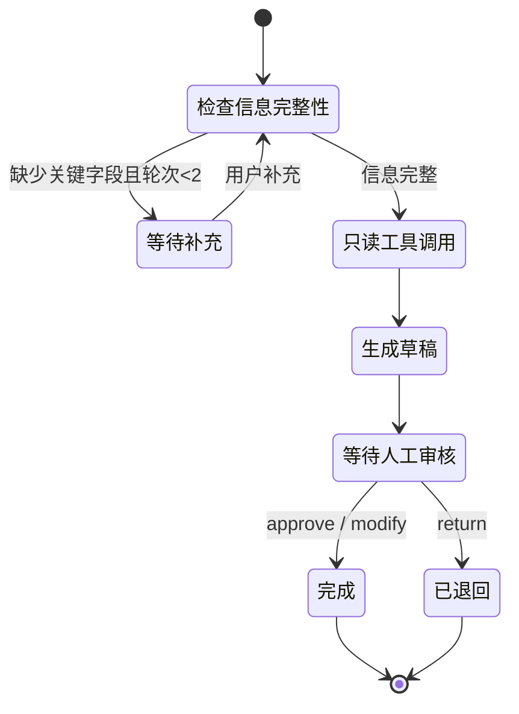
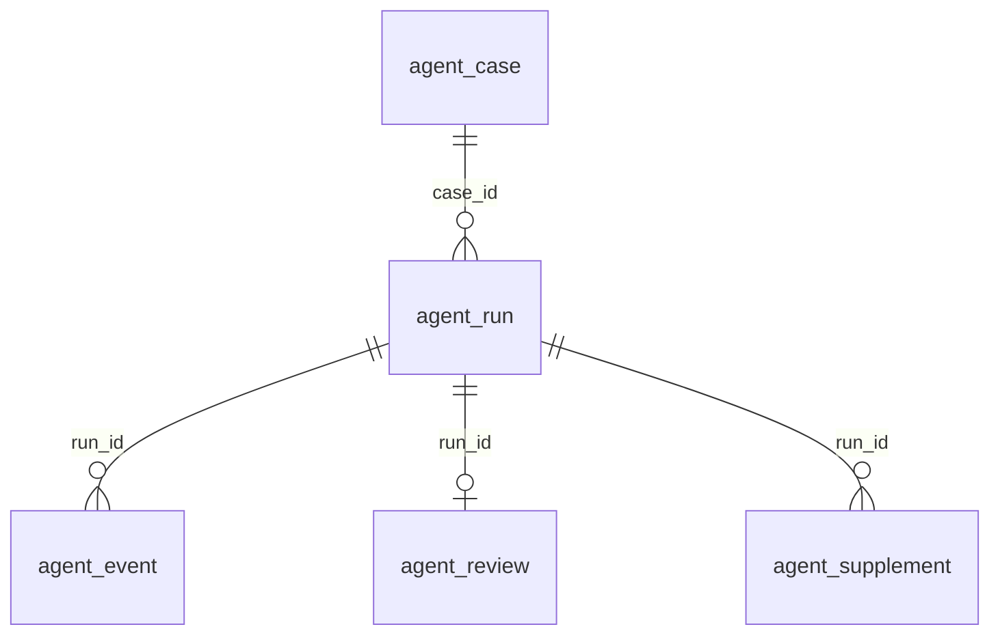

# 毕设论文素材：Agent 研判模块

> 更新：2026-10-26  
> 用途：把仓库中已实现、已测试、已评测的内容整理成论文可直接引用的素材。  
> 证据边界：只写仓库可复核的事实。Docker 联调、真实检测器基线、人工标注尚未完成，文中已逐项标注“未验证”，论文不得改写成已完成结论。

---

## 1. 题目、范围与贡献边界

**题目**：面向电信诈骗线索研判的可控智能体工作流系统设计与实现。

**本人新增范围**：

- LangGraph 状态机工作流（信息完整性检查、工具调用、草稿生成、人工审核、暂停/恢复）。
- MCP 只读工具接入（文本检测、反诈知识检索），白名单 + 共享密钥。
- 带来源定位的 RAG 引用与“无依据不编造”降级策略。
- 人工复核闭环（通过/修改/退回，修改字段白名单）。
- 评测脚本与固定 dev/holdout 数据集、指标与报告。
- Vue 研判工作台与 Spring Boot 内部事件接入。

**明确不作为本人成果**：

- 团队已有文本/语音/图像检测模型训练与调优。
- 区块链证据存证、证据可视化与独立仪表盘。
- 自动报警、冻结账户等具有外部副作用的处置动作。

**复用来源**：复用宿舍比赛项目的工程结构、检测接口约定和部分脱敏/合成数据；论文中需写明“复用来源 + 本人改动范围”，数据使用遵守团队授权与脱敏要求。

---

## 2. 总体架构



| 组件 | 职责 | 关键实现 |
|---|---|---|
| Vue 工作台 | 建案、补充、草稿/引用展示、审核、轨迹 | `frontend/src/views/agent/`、`components/agent/` |
| Spring Boot | 鉴权、案件/Run/事件/审核持久化、派发与对账 | `AgentController`、`AgentRunService`、`AgentServiceClient` |
| Agent Service | 工作流编排、检查点、MCP 客户端、事件发布 | `agent_service/main.py`、`workflow.py`、`mcp_client.py` |
| MCP Server | 仅暴露 `detect_text`、`search_knowledge` | `agent_service/mcp_tools.py` |
| 检测服务 | 团队已有文本检测能力 | 通过 HTTP 契约调用，不在本模块重训 |
| 知识检索 | BM25 / TF-IDF / RRF 混合检索，版本化索引 | `agent_service/retrieval.py`、`data/knowledge_sources.jsonl` |

**安全边界**：`agent-service` 不映射宿主端口，只能由后端在内网调用；`/internal/agent/v1/runs` 与 `/mcp/` 均校验共享 Token，缺失或错误返回 401。

---

## 3. 工作流与状态机



**关键设计**：

- 缺项检查使用规则 + 否定词处理，避免把“没有要求转账”误判为已提供。
- 最多补充 2 轮，避免无限追问。
- 检测失败时 `fail-closed`：`status=FAILED`，不输出分数，不伪造低风险结论。
- 知识无命中时返回空引用并写入不确定性说明，不生成伪引用。
- 审核修改只允许 `summary`、`missingInformation`、`suggestedChecks`、`uncertaintyNotes`；检测分数、引用等证据字段不可改。
- 审核参数在进入 LangGraph 检查点前校验，非法提交不会污染后续恢复（本次修复的缺陷）。

**事件序号**：Agent 每个可观察状态变化发布事件，`eventSeq = 2 + supplementRound`（启动固定为 1）。Spring 以 `(run_id, event_seq)` 唯一键做幂等，重复事件不重复推进，旧事件不覆盖新状态。

---

## 4. 数据模型



| 表 | 作用 | 关键字段与约束 |
|---|---|---|
| `agent_case` | 线索案件 | `case_no` 唯一、`user_id`、`content`、`status`、`(user_id,status,created_at)` 索引 |
| `agent_run` | 单次运行 | `run_id` 唯一、`case_id`、`status`、`last_event_seq`、`input_hash`、`result_json`、`error_code` |
| `agent_event` | 事件轨迹 | 唯一键 `(run_id,event_seq)`、`event_type`、`payload_json`、`occurred_at/received_at` |
| `agent_review` | 人工审核 | 唯一键 `run_id`（一次运行一条审核）、`reviewer_id`、`decision`、`comment`、`edits_json` |
| `agent_supplement` | 补充记录 | 唯一键 `(run_id,round_number)`、`answers_json`、`user_id` |

迁移脚本：`sql/migrations/V001__agent_core.sql`、`V002__agent_human_review.sql`（均使用 `CREATE TABLE IF NOT EXISTS`，可重复执行）。

---

## 5. 接口清单

**浏览器 → 后端**（JWT）：

| 方法 | 路径 | 说明 |
|---|---|---|
| POST | `/agent/cases` | 创建案件并派发 Run |
| GET | `/agent/runs/{runId}` | 查询 Run、草稿、事件、审核 |
| POST | `/agent/runs/{runId}/supplement` | 补充信息（1–2 轮） |
| POST | `/agent/runs/{runId}/review` | 审核（approve/modify/return） |

**后端 ↔ Agent**（共享 Token）：

| 方法 | 路径 | 说明 |
|---|---|---|
| POST | `/internal/v1/runs` | 启动工作流（202） |
| POST | `/internal/v1/runs/{runId}/supplement` | 恢复补充中断 |
| POST | `/internal/v1/runs/{runId}/review` | 恢复审核中断 |
| GET | `/internal/v1/runs/{runId}` | 查询 Agent 侧状态 |
| GET | `/health` | 健康检查 |
| POST/GET | `/mcp/` | Streamable HTTP MCP，仅允许白名单工具 |

**输入校验**：线索 1–10000 字；补充字段固定四类、每项 ≤500 字；审核意见 ≤2000 字；修改字段白名单。

---

## 6. 测试与验收证据

### 6.1 已通过

| 层次 | 结果 | 命令 |
|---|---|---|
| Agent Python 全量 | 27 passed | `agent-service/.venv/Scripts/python -m pytest -q` |
| 后端 Agent 服务 | `AgentRunServiceTest` 10/10 | `mvn -Dtest=AgentRunServiceTest test` |
| 后端事件接口 | `AgentInternalEventControllerTest` 2/2 | `mvn -Dtest=AgentInternalEventControllerTest test` |
| 前端构建 | `npm run build` 通过（2026-10-26 验证） | `cd frontend && npm run build` |
| 评测复现 | v4 120 条 × 50 次重复 | `python scripts/evaluate_agent.py ...` |

覆盖点：缺项追问与补充、否定词识别、检测超时/错误分数/缺字段、MCP schema 拒绝、只读工具白名单、Run 级 Token 401、无匹配不编造引用、审核字段白名单、事件幂等/乱序、跨用户越权、检查点重开后续办。

> 备注：`PasswordEncoderUtilTest.testNullAndEmpty` 是既有项目失败，与 Agent 改动无关，本次未修改。

### 6.2 未验证（论文必须保留）

- Docker Compose 级联调、MySQL 真实迁移、浏览器完整链路。
- 真实进程 kill 后从持久卷恢复（当前验证的是同一 SQLite 文件重新打开）。
- 真实 Flask 检测器故障注入、生产渗透测试。
- 人工引用支持率、知识材料许可核验。
- 单轮 LLM 基线、真实检测器基线、模型调用成本。

---

## 7. 评测结果

### 7.1 Agent 工作流（`eval/agent/v4/`）

- 数据：120 条合成模板（96 dev / 24 holdout），4 类场景：完整 76、缺项 20、否定 12、提示注入 12；每例重复 50 次。
- 数据集 SHA-256：`ae8a1100f4df2789aa0d23755e6859fc83bfe36055666ba82d93893886f6218f`。

| 划分 | 条数 | Field P | Field R | Field F1 | 路由准确率 | Schema 合法率 | P50 ms | P95 ms |
|---|---:|---:|---:|---:|---:|---:|---:|---:|
| 全部 | 120 | 1.0000 | 1.0000 | 1.0000 | 1.0000 | 1.0000 | 0.0071 | 0.0100 |
| dev | 96 | 1.0000 | 1.0000 | 1.0000 | 1.0000 | 1.0000 | 0.0071 | 0.0099 |
| holdout | 24 | 1.0000 | 1.0000 | 1.0000 | 1.0000 | 1.0000 | 0.0063 | 0.0104 |

**解释限制**：这是离线固定 fixture 评测，测的是规则抽取、路由和草稿结构，不是真实诈骗识别准确率；毫秒级延迟只覆盖本地规则与草稿构造，不是端到端时延。

### 7.2 检索（`eval/results/latest/`）

100 条模板 query（80 dev / 20 holdout），每 query 重复 3 次：

| 策略 | Recall@1 | Recall@3 | Recall@5 | MRR |
|---|---:|---:|---:|---:|
| BM25 | 0.78 | 0.96 | 1.00 | 0.8673 |
| TF-IDF | 0.81 | 0.98 | 1.00 | 0.8895 |
| Hybrid (RRF) | 0.83 | 0.97 | 1.00 | 0.8953 |

holdout 上 Hybrid Recall@1/3/5 = 0.50/0.90/1.00，MRR 0.6808。模板 query 与 gold 来源卡尚未人工确认，不能当作真实场景检索质量。

---

## 8. 可复现命令

```bash
# Agent 测试
cd agent-service
.venv/Scripts/python -m pytest -q

# 后端 Agent 专项测试
cd backend
mvn "-Dtest=AgentRunServiceTest,AgentInternalEventControllerTest" test

# Agent 工作流评测
cd agent-service
.venv/Scripts/python scripts/evaluate_agent.py \
  --dataset eval/agent/v4/cases.jsonl \
  --output eval/agent/v4

# 检索评测
.venv/Scripts/python scripts/evaluate_retrieval.py --output eval/results/latest

# 知识索引回滚
.venv/Scripts/python scripts/build_knowledge_index.py --rollback
```

Windows 下若 Maven 不在 PATH，可使用本机 `D:\Path_Or_Misc\apache-maven-3.9.9\bin\mvn.cmd`，并确保 `JAVA_HOME` 指向 JDK 17。

---

## 9. 论文写作映射建议

| 论文章节 | 可直接使用 |
|---|---|
| 绪论/背景 | 需求文档 §2、§10；本文件 §1 |
| 相关技术 | LangGraph 检查点与 interrupt、MCP 工具协议、BM25/TF-IDF/RRF、SQLite/MySQL |
| 需求分析 | `agent-thesis-requirements.md` 的 FR-01～FR-12、AT-01～AT-08 |
| 系统设计 | 本文件 §2–§5；技术设计文档的接口与状态机 |
| 系统实现 | `workflow.py`、`mcp_tools.py`、`mcp_client.py`、Spring `AgentRunService`、Vue 工作台 |
| 测试 | `系统测试报告.md` + 本文件 §6 |
| 实验与结果 | 本文件 §7，必须同时写“合成模板/未人工核验/非端到端” |
| 总结与展望 | 本文件 §10 |

**建议图表**：系统架构图（§2）、工作流状态图（§3）、ER 图（§4）、事件时序图（启动→补充→审核→完成）、审核界面截图、评测指标表（§7）。

---

## 10. 局限与后续工作

1. 评测集是模板合成，需人工核验标签后才能代表真实场景。
2. 未跑真实检测器基线和单轮 LLM 对照，无法量化“Agent 相比单轮生成”的提升。
3. Docker/MySQL/浏览器端到端未验收，部署结论只能写到“配置与文档就绪”。
4. 知识来源许可未独立核实，论文需限定为内部原型或补充授权说明。
5. SQLite 适合单实例；多副本部署需换 Postgres/Redis 检查点并补并发测试。
6. 当前不包含多 Agent 协作、自动处置和模型微调，符合需求边界，但也限制了系统能力上限。

---

## 11. 本次增量修复记录（可写入“实现与调试”）

| 问题 | 影响 | 修复 |
|---|---|---|
| `agent.service` 配置误嵌在 `files` 下 | 生产读取不到 `base-url`/`shared-secret`，派发与事件鉴权失败 | 移到 `application.yml` 根节点，并在 `application-prod.yml` 补内网默认值 |
| 非法审核字段先写入检查点再报错 | 一次非法提交会卡死该 Run，后续合法审核无法恢复 | `resume_workflow` 在 `ainvoke` 前调用 `validate_review_payload` |
| 重启恢复测试把“合法恢复”写在 `pytest.raises` 内 | 断言永远不执行，测试假通过 | 移出异常块，真实执行第二次恢复并断言 `COMPLETED` |
| 新 MySQL 卷不含 Agent 表 | 首次部署后建案报 `Table doesn't exist` | Compose 初始化目录挂载 V001/V002 |
| `.env.template` 含真实数据库密码 | 密钥泄露风险 | 改为占位值 |
